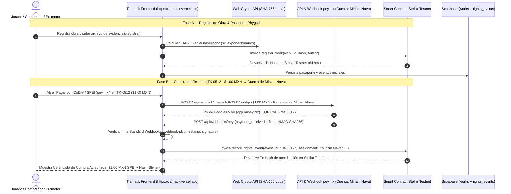

# Guía de Evaluación End-to-End (E2E) para el Jurado — Tlamatik · Pasaporte Cultural & Comercio Justo

> **Propósito de este documento**: Guiar al jurado paso a paso a través de una prueba integral **End-to-End (E2E)** de **Tlamatik**, validando el registro criptográfico de una pieza artesanal en **Stellar Soroban Testnet**, su compra por **$1.00 MXN** mediante **CoDi® / SPEI (`pey.mx`)** con depósito directo a la cuenta activa de la maestra artesana **Miriam Nava** (CLABE: `012180015355682429`), la recepción del **Webhook firmado (HMAC-SHA256)** y la **acreditación dual on-chain + bancaria** sin intermediarios.

---

## 1. Arquitectura E2E que Evaluará el Jurado



### Identificadores Técnicos en Vivo (Stellar Testnet & `pey.mx`)

| Componente | Valor / Identificador |
| :--- | :--- |
| **URL de Producción (Vercel)** | https://tlamatik.vercel.app/ |
| **Endpoint Webhook `pey.mx` (Vivo)** | `https://tlamatik.vercel.app/api/webhooks/pey` (`POST` eventos / `GET` healthcheck) |
| **Pieza Insignia para Prueba E2E** | `TK-0512` — *El Guardián del Monte: Tecuani de Acatlán* |
| **Precio de Prueba E2E** | **`$1.00 MXN`** (`$1.00` obra + `$0.00` certificado + `$0.00` envío = **`$1.00 MXN`**) |
| **Cuenta Beneficiaria Activa (`pey.mx`)** | **Miriam Nava** (CLABE: `012180015355682429` · BBVA) |
| **Red Blockchain** | `Stellar Testnet` (`Test SDF Network ; September 2015`) |
| **Smart Contract ID (Soroban)** | `CAOAFGPATXWJ6KKGXFYHY42Q4N75NOWSR3NH3K2DT7QR3YSMDGT5P2HO` |
| **WASM Hash Desplegado** | `ba7d1753ecf002984aee4a87c80b64af6bc1a819ed27bfa98162a9b4cfd2bcaa` |
| **Explorador del Contrato** | https://stellar.expert/explorer/testnet/contract/CAOAFGPATXWJ6KKGXFYHY42Q4N75NOWSR3NH3K2DT7QR3YSMDGT5P2HO |
| **Tx Hash Ejemplo (`register_work`)** | `725e126cc7998b795f328f99e9ba60d863202d06aa1166016d0cd573eadd48cf` |
| **Tx Hash Ejemplo (`record_rights_event`)** | `30f6f7e9a1df1187d0a6c57ba86eaecebafcb4d8e2af7e12930a160930359199` |

---

## 2. Acceso Directo en Producción o Preparación Local

- **Opción A — Evaluación inmediata en la nube (Recomendada)**:
  Abrir directamente **https://tlamatik.vercel.app/** en cualquier navegador (no requiere instalación local).
- **Opción B — Evaluación en entorno local**:
  1. Instalar dependencias e iniciar el servidor de desarrollo:
     ```bash
     npm install
     npm run dev
     ```
  2. Abrir en el navegador: `http://localhost:8080`.

---

## 3. Recorrido Paso a Paso para el Jurado (5 Escenarios E2E)

### Escenario 1: Compra del Tecuani (`TK-0512`) por `$1.00 MXN` → Cuenta de Miriam Nava (`pey.mx` + Webhook + Smart Contract Stellar)

**Objetivo**: Comprobar cómo el cobro de **`$1.00 MXN`** dirigido a la cuenta bancaria activa de **Miriam Nava** (CLABE: `012180015355682429`) en `pey.mx` dispara el webhook firmado (`HMAC-SHA256`), ejecuta automáticamente el Smart Contract en **Stellar Testnet** (`record_rights_event`) y entrega al comprador el comprobante con ambos acuses (bancario SPEI y blockchain).

1. **Ir al Mercado o Verificador**:
   - Navegar a [`https://tlamatik.vercel.app/mercado`](https://tlamatik.vercel.app/mercado) o abrir directamente el pasaporte del Tecuani en [`https://tlamatik.vercel.app/verificar?id=TK-0512`](https://tlamatik.vercel.app/verificar?id=TK-0512).
2. **Abrir la Pasarela CoDi® / SPEI (`pey.mx`)**:
   - En la tarjeta de **"El Guardián del Monte: Tecuani de Acatlán"** (`TK-0512` · Artesana: **Miriam Nava** · Precio: **`$1 MXN`**), hacer clic en el botón verde **"Pagar con CoDi® / SPEI (pey.mx)"**.
3. **Revisar la Orden de `$1.00 MXN` y el Beneficiario**:
   - **Pieza**: `TK-0512` — *El Guardián del Monte: Tecuani de Acatlán*.
   - **Cuenta Beneficiaria Activa**: **Miriam Nava** (CLABE: `012180015355682429` · `Acatlán de Osorio, Puebla`).
   - **Valor de la Obra (Prueba E2E)**: **`$1.00 MXN`** (`$0.00 MXN` certificado + `$0.00 MXN` envío = **`$1.00 MXN` total a liquidar**).
4. **Escanear el Código QR y Realizar el Pago de `$1.00 MXN`**:
   - **Modalidad A — App Bancaria con CoDi® (Lector "Pagar QR")**:
     - En el modal de pago, seleccionar la pestaña **"📱 App Bancaria (CoDi®)"**.
     - El código QR contiene la trama estructurada estándar de **Banco de México CoDi** (`TYP: 20`, Beneficiaria `Miriam Nava`, CLABE `012180015355682429`, Monto `$1.00 MXN`, Referencia `0512`).
     - *Nota técnica sobre lectores bancarios CoDi*: Ciertas apps bancarias en México (como BBVA o Santander) exigen que el QR contenga una firma criptográfica centralizada (`CRY`) emitida en tiempo real por el HSM de Banxico vinculada a una cuenta enrolada en su padrón. Si la app bancaria indica *"Este QR no es válido"*, se debe a la ausencia de dicha firma criptográfica de Banxico. En ese caso, puedes presionar directamente el botón **"Pagar con CoDi"** abajo o usar la Modalidad B con la cámara normal.
   - **Modalidad B — Escaneo con la Cámara del Celular / Portal pey.mx**:
     - Seleccionar la pestaña **"📷 Cámara / pey.mx"**.
     - Escanear el QR con la **cámara estándar de tu teléfono** o hacer clic en **"Abrir Payment Link en pey.mx"** (`https://app.mipey.mx/checkout/payment-link/...`) para abrir la pasarela web de `pey.mx`.
   - **Modalidad C — Acreditación Directa E2E en Plataforma**:
     - Hacer clic en el botón **"Pagar con CoDi"**.
   - Observar la secuencia en tiempo real de 3 etapas:
     1. `1/3 · Evento Webhook de pey.mx recibido y verificado (HMAC-SHA256)`
     2. `2/3 · Ejecutando Smart Contract Soroban en Stellar Testnet (record_rights_event)…`
     3. `3/3 · Generando comprobante dual (SPEI Banxico + Hash Stellar)`
5. **Auditar el Certificado de Compra Acreditada**:
   - Verificar en pantalla la respuesta consolidada de ambos eventos:
     - **Resumen del Cobro Liquidado**: **`$1.00 MXN`** acreditado a **Miriam Nava**.
     - **1. Evento de Pago (`Webhook pey.mx · SPEI`)**:
       - `Beneficiaria`: **Miriam Nava** (CLABE: `012180015355682429`)
       - `Webhook ID`: `msg_...` con insignia **`HMAC-SHA256 OK`**
       - `Transaction ID`: identificador de transacción de `pey.mx`
       - `CoDi QR ID` (`35a13c0512`) y `Referencia` (`0512`)
       - **Clave de Rastreo SPEI (CEP Banxico)** (con botón para copiar).
     - **2. Smart Contract Stellar Testnet (Soroban)**:
       - `Contract ID`: `CAOAFGPATXWJ6KKGXFYHY42Q4N75NOWSR3NH3K2DT7QR3YSMDGT5P2HO`
       - `Función Invocada`: `record_rights_event (assignment)`
       - `Event ID On-Chain`: `EVT-WH-...`
       - **Hash de Transacción Stellar Testnet (64 hex)** (con botón para copiar).
       - **Hash SHA-256 de la Pieza / Pasaporte (64 hex)** (con botón para copiar).
6. **Descargar el Certificado y Verificar en Stellar Expert**:
   - Hacer clic en **"Descargar Certificado"** para obtener el certificado HTML imprimible con ambos hashes.
   - Hacer clic en **"Ver en Stellar Expert ↗"** para inspeccionar la transacción en el explorador de **Stellar Testnet**.

---

### Escenario 2: Verificación Pública y Auditoría Binaria SHA-256 (`/verificar`)

1. Ir a [`https://tlamatik.vercel.app/verificar`](https://tlamatik.vercel.app/verificar).
2. Seleccionar `TK-0512`, `TK-0042` o `TK-0108`, o pegar un hash SHA-256 de 64 caracteres.
3. Revisar la sección **"Historial de Derechos y Evidencia (Soroban Rights Events)"** (`registration`, `evidence`, `license`, `assignment`).
4. Hacer clic en **"Auditar archivo local (SHA-256)"** y subir cualquier archivo para comprobar el cálculo SHA-256 en el navegador.

---

### Escenario 3: Registro de Promotor Comunitario (`/promotor`)

1. Ir a [`https://tlamatik.vercel.app/promotor`](https://tlamatik.vercel.app/promotor).
2. Completar los campos del expediente y observar el avance porcentual y la **Vista Previa de Credencial en Vivo**.

---

### Escenario 4: Registro Criptográfico de una Nueva Obra (`/registrar`)

1. Iniciar sesión en `/auth` y navegar a `/registrar`.
2. Completar los 3 pasos (*Datos de la Pieza*, *Evidencia del Saber*, *Minting Criptográfico*) y anclar la obra en el contrato Soroban de Stellar Testnet.

---

### Escenario 5: Panel del Embajador y Monitor de Webhooks (`/panel`)

1. Navegar a `/panel`.
2. Probar el alta de artesano con **hash SHA-256 con sal para datos bancarios** y el **Monitor en Vivo de Webhooks `pey.mx` + SPEI** (donde aparece la liquidación de **`$1.00 MXN`** para **Alain Bonilla**).

---

## 4. Prueba Técnica con `cURL` y Suite de Tests

```bash
# Consultar salud y eventos recientes del webhook en producción
curl -s https://tlamatik.vercel.app/api/webhooks/pey | jq .

# Ejecutar la suite completa de pruebas automatizadas localmente
npm test
```
