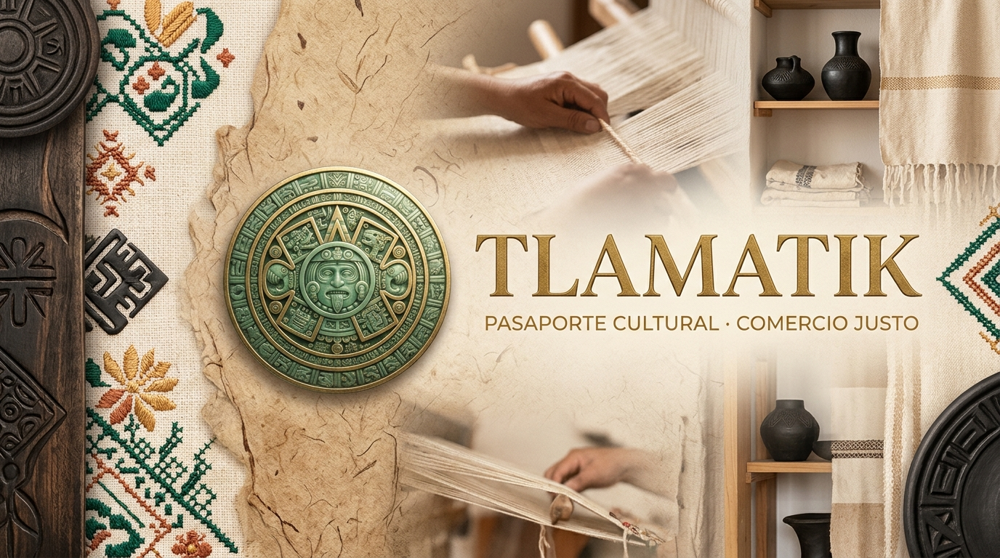
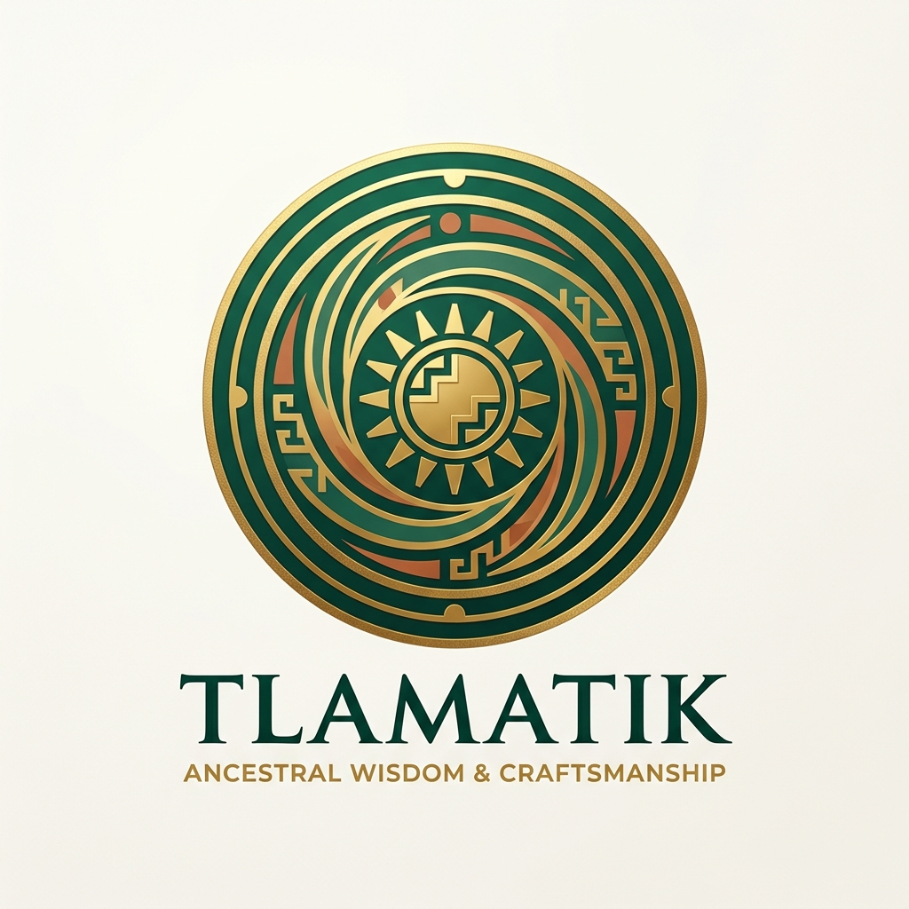
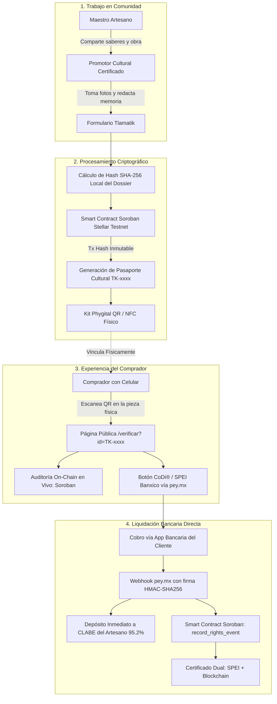
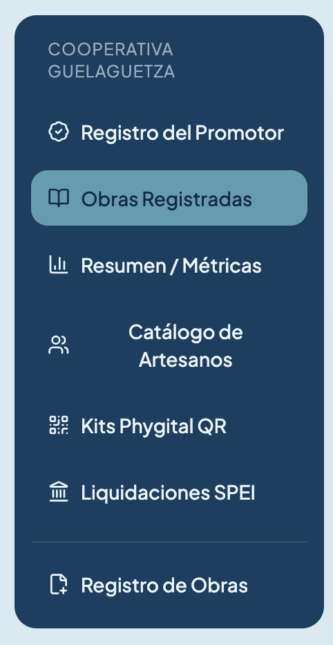
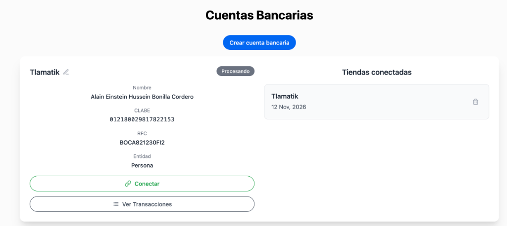
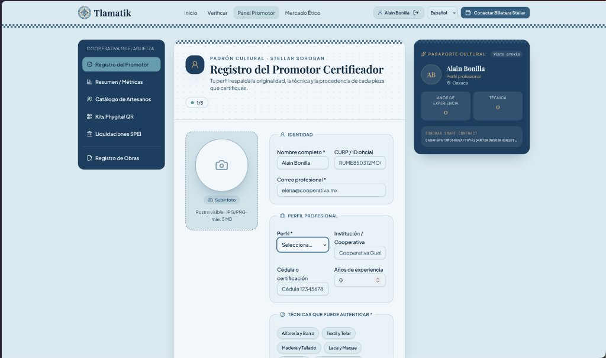
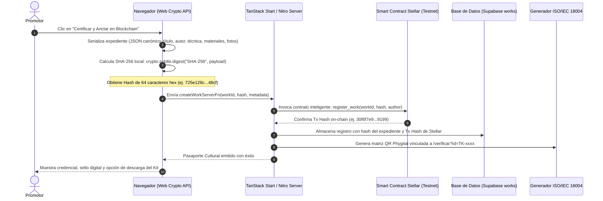
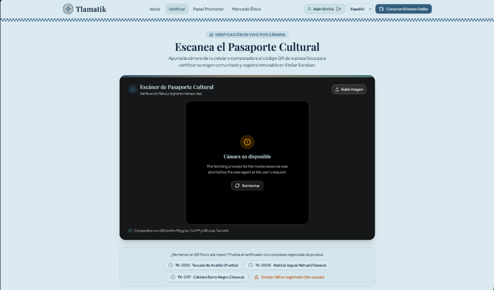
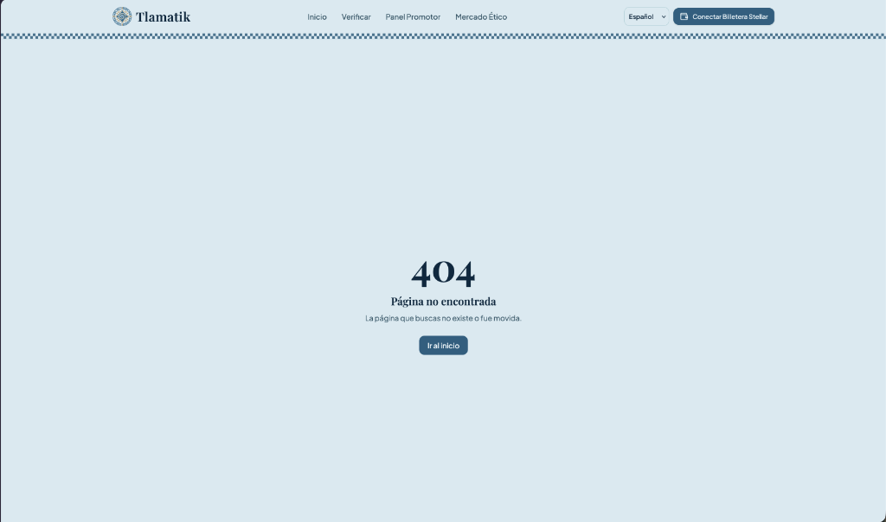
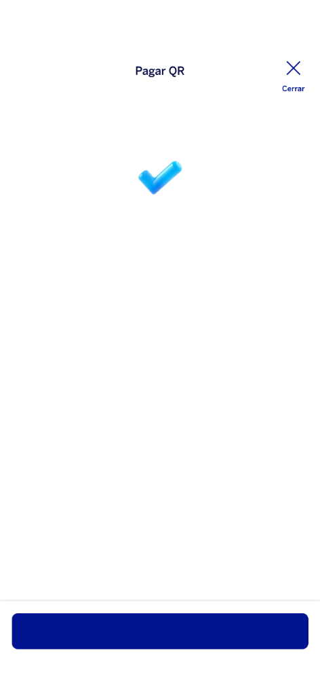

# Tlamatik — Guía Operativa y Manual de Uso de la Plataforma
## Pasaporte Cultural Phygital, Registro de Obras en Blockchain Stellar Soroban y Liquidaciones Directas SPEI / CoDi®



---

> **Documento Operativo Oficial — Versión 1.0**  
> **Proyecto:** Tlamatik (Ancestral Craft Passport)  
> **Área:** Operaciones de Campo, Red de Promotores Comunitarios y Certificación Tecnológica  
> **Tecnologías Centrales:** Stellar Soroban Testnet, Web Crypto API (SHA-256), `pey.mx` (CoDi® / SPEI de Banxico), React 19, Tailwind CSS.  
> **Compatibilidad de exportación:** Microsoft Word (.docx), Google Docs, PDF vía Markdown / Pandoc.

---

## Índice de Contenido

1. [Introducción y Visión General](#1-introducción-y-visión-general)
   - 1.1 El Desafío: Regateo, Intermediación Opaque y Plagio Cultural
   - 1.2 La Propuesta de Valor de Tlamatik
   - 1.3 Arquitectura Funcional Integral (Diagrama de Flujo)
2. [El Rol del Promotor Cultural](#2-el-rol-del-promotor-cultural)
   - 2.1 La Figura del Promotor: Puente Humano y Garante de Confianza
   - 2.2 Proceso de Registro y Autenticación del Promotor (Paso a Paso)
   - 2.3 Responsabilidad Ética, Legal y Consentimiento Comunitario
3. [Catálogo y Registro de Artesanos](#3-catálogo-y-registro-de-artesanos)
   - 3.1 Acceso al Módulo y Navegación en el Panel
   - 3.2 Formulario de Alta y Edición de Artesanos
   - 3.3 ¿Por qué se solicitan Datos Bancarios (CLABE, Banco, Titular)?
   - 3.4 Seguridad, Privacidad y Criptografía: Hashes Salteados SHA-256
4. [Registro de Obras y Pasaportes Culturales (Paso a Paso)](#4-registro-de-obras-y-pasaportes-culturales-paso-a-paso)
   - 4.1 Flujo Operativo en el Formulario de Registro
   - 4.2 Documentación de la Memoria: Técnica, Materiales, Simbología y Fotos
   - 4.3 Qué Sucede Tras Bambalinas al Certificar una Obra:
     - 4.3.1 Cálculo del Hash Criptográfico SHA-256 del Dossier
     - 4.3.2 Qué se registra en la Blockchain (Stellar Soroban) y qué NO
     - 4.3.3 Estructura del Smart Contract (`register_work` y `record_rights_event`)
     - 4.3.4 Generación del ID Único del Pasaporte Cultural
5. [Módulo de Kits Phygital QR y Anclaje Físico-Digital](#5-módulo-de-kits-phygital-qr-y-anclaje-físico-digital)
   - 5.1 ¿Qué es un Kit Phygital?
   - 5.2 Información Codificada en el Código QR (Estándar ISO/IEC 18004)
   - 5.3 Opciones y Catálogo de Etiquetas Físicas para los Talleres:
     - Opción A: Telar Tradicional con Micro-QR Bordado
     - Opción B: Papel Amate o Algodón con Sello Lacrado / Grabado Láser
     - Opción C: Placas de Cerámica o Metal Pulido
     - Opción D: Tags NFC Encapsulados en Resina Ecológica
   - 5.4 Experiencia del Comprador: Verificación Instantánea sin Criptomonedas
6. [Liquidaciones SPEI / CoDi® y Desglose Transparente](#6-liquidaciones-spei--codi-y-desglose-transparente)
   - 6.1 El Modelo "Buyer Premium": 95.2% Artesano / 4.8% Certificación
   - 6.2 Integración con `pey.mx` (CoDi® y Enlaces de Pago Bancario)
   - 6.3 Ciclo de Vida del Webhook Firmado (HMAC-SHA256)
   - 6.4 Certificado Dual de Compra Acreditada (SPEI + Blockchain)
7. [Módulo de Métricas, Trazabilidad y Auditoría](#7-módulo-de-métricas-trazabilidad-y-auditoría)
   - 7.1 Indicadores Clave de Desempeño (KPIs) en el Panel de Control
   - 7.2 Monitoreo de Derrama Económica Comunitaria ($MXN)
   - 7.3 Auditoría Pública On-Chain (`BlockchainAuditPanel`) y Explorador Stellar Expert
8. [Apéndices](#8-apéndices)
   - Apéndice A: Glosario de Términos Técnicos y Culturales
   - Apéndice B: Protocolo de Consentimiento Previo e Informado (Ley de Protección del Patrimonio Cultural)
   - Apéndice C: Preguntas Frecuentes (FAQ) para Promotores y Artesanos

---

## 1. Introducción y Visión General

### 1.1 El Desafío: Regateo, Intermediación Opaque y Plagio Cultural
El arte popular y la artesanía tradicional mexicana representan milenios de saberes ancestrales, cosmovisión comunitaria e identidad viva de pueblos originarios (Zapotecos, Mixtecos, Nahuas, Purépechas, Huicholes, entre otros). A pesar de su incalculable valor histórico y estético, el ecosistema artesanal enfrenta tres problemas críticos y sistemáticos:

1. **Intermediación Desmedida:** Los artesanos rurales suelen recibir menos del 15% al 25% del precio final en galerías turísticas o tiendas de lujo en zonas metropolitanas.
2. **Plagio y Apropiación Indebida:** Marcas internacionales de "fast-fashion" y producción industrial extranjera clonan patrones sagrados sin atribución de origen, sin consentimiento comunitario y sin retribución económica.
3. **Brecha Digital y Financiera:** La mayoría de los maestros artesanos no poseen terminales punto de venta (TPV) bancarias ni infraestructura de comercio electrónico, y mucho menos billeteras de criptomonedas o conocimiento sobre redes blockchain complejas.

### 1.2 La Propuesta de Valor de Tlamatik
**Tlamatik** nace para erradicar estas asimetrías mediante una combinación innovadora de **tecnología web moderna, anclaje físico-digital (Phygital), registros inmutables en Stellar Soroban y pagos directos en moneda nacional ($MXN) a través de CoDi® y SPEI**.



Nuestros pilares fundamentales son:
- **Inclusión Financiera Real:** No obligamos a las comunidades a aprender Web3 ni a lidiar con criptomonedas o volatilidad cambiaria. El comprador puede pagar mediante CoDi® (cero comisiones) o SPEI desde cualquier aplicación de banca móvil mexicana, y el artesano recibe el 95.2% del importe directamente en su tarjeta de débito habitual.
- **Sello Inmutable de Origen:** La blockchain se reserva estrictamente para lo que mejor sabe hacer: ser un **notario digital público, permanente e incorruptible**. Cada pieza lleva un Pasaporte Cultural respaldado por un Smart Contract en Stellar Soroban con el hash criptográfico SHA-256 de su expediente de origen.
- **Comercio Ético y Derechos de Propiedad Colectiva:** Los diseñadores o marcas que deseen licenciar patrones tradicionales deben registrar la sesión de derechos en la blockchain con regalías automáticas para la comunidad.

---

### 1.3 Arquitectura Funcional Integral (Diagrama de Flujo)



---

## 2. El Rol del Promotor Cultural

### 2.1 La Figura del Promotor: Puente Humano y Garante de Confianza
En **Tlamatik**, la tecnología no busca sustituir las relaciones comunitarias, sino potenciarlas. Las comunidades artesanas son predominantemente de tradición oral, muchas se ubican en zonas con intermitencia de telecomunicaciones y resguardan técnicas familiares que requieren un trato ético y de máxima dignidad.

El **Promotor Cultural** es la figura más importante dentro de la plataforma porque:
- **Es el vínculo humano y de confianza:** Conoce a las familias de maestros artesanos, visita los talleres comunitarios, comprende las variantes lingüísticas y los contextos socioculturales de cada región (Valles Centrales, Sierra Sur, Montaña de Guerrero, Huasteca, etc.).
- **Es el curador y certificador de autenticidad:** Verifica in situ que las piezas sean auténticas, elaboradas con técnicas tradicionales y materiales genuinos (lana teñida con grana cochinilla, copal tallado a mano, barro negro cocido en horno de dos bocas, cobre martillado a fuego, etc.).
- **Facilita la inclusión digital:** Asiste al maestro artesano en la recopilación de los datos de su taller, fotografía las obras con la iluminación adecuada y captura las evidencias que conforman el expediente digital.



---

### 2.2 Proceso de Registro y Autenticación del Promotor (Paso a Paso)

El acceso a las funciones operativas de certificación y administración de talleres está estrictamente protegido bajo una capa de autenticación:

1. **Ingreso a la Plataforma:** El promotor accede a `https://tlamatik.vercel.app/auth` o hace clic en **"Panel Promotor"** en la barra superior.
2. **Inicio de Sesión Seguro:**
   - La plataforma soporta acceso mediante correo corporativo/institucional o autenticación federada con Google Workspace.
   - De acuerdo con la arquitectura de seguridad del proyecto, el login delega a una página pública de intercambio antes de transferir la sesión hacia la ruta protegida `_authenticated/panel`.
3. **Configuración del Perfil de Promotor:**
   - En su primer acceso, el promotor completa su ficha con: Nombre Completo, Organización o Cooperativa de Adscripción (ej. *Guelaguetza Cooperativa*, *FONART*, *Maestros del Oficio A.C.*), Región de Cobertura y Teléfono de Contacto Comunitario.
   - *Nota de seguridad:* Los títulos profesionales o cargos descriptivos son metadata de referencia comunitaria y nunca roles arbitrarios de escalamiento de privilegios.

---

### 2.3 Responsabilidad Ética, Legal y Consentimiento Comunitario
El promotor cultural actúa bajo el marco de la **Ley General de Protección del Patrimonio Cultural de los Pueblos y Comunidades Indígenas y Afromexicanas**. Antes de registrar cualquier pieza o patrón tradicional, el promotor debe recabar el **Consentimiento Libre, Previo e Informado (CLPI)** del taller o asamblea ejidal/comunal correspondiente, garantizando que:
- La difusión de la obra respete los elementos sagrados o no divulgables de la cosmovisión local.
- Los fondos obtenidos de las ventas y posibles regalías por licenciamiento lleguen íntegramente a las manos de los creadores.

---

## 3. Catálogo y Registro de Artesanos

### 3.1 Acceso al Módulo y Navegación en el Panel
Una vez dentro del **Panel del Promotor**, en la pestaña **"Directorio Comunitario" / "Artesanos"**, el promotor cuenta con una vista integral que lista a todos los maestros registrados en su red territorial. 

La interfaz permite:
- Visualizar el listado con fotografía, nombre, comunidad de origen, técnica tradicional, número de piezas catalogadas y estatus de validación (Verificada / Pendiente).
- Buscar rápidamente por nombre o localidad mediante el campo de filtrado en vivo.
- Hacer clic en el botón principal **"+ Registrar Nuevo Artesano"** para desplegar el formulario completo de alta.

---

### 3.2 Formulario de Alta y Edición de Artesanos
El registro de un nuevo maestro artesano recopila tanto su identidad artística como su infraestructura de recepción de pagos:

| Campo | Tipo | Propósito | Ejemplo |
| :--- | :--- | :--- | :--- |
| **Nombre Completo** | Texto | Nombre y apellidos del maestro o titular del taller | *Don Miguel Aguilar Jiménez* |
| **Comunidad y Estado** | Texto / Select | Localidad exacta de producción artesanal | *San Antonio Arrazola, Oaxaca* |
| **Técnica Ancestral** | Select | Categoría técnica representativa | *Talla en madera de copal (Alebrijes)* |
| **Biografía y Trayectoria** | Área de Texto | Historia del taller, linaje artesanal y premios | *Tres generaciones tallando copal verde con machete...* |
| **Fotografía del Taller** | Archivo / Cámara | Imagen de perfil o trabajando en su banco | Archivo JPG/PNG en alta resolución |
| **Banco Receptor** | Select | Institución financiera mexicana receptora | *BBVA Bancomer, Banco Azteca, BanCoppel, Bienestar* |
| **Número de Cuenta / Tarjeta** | Numérico | Número plástico o cuenta de depósito | 16 dígitos de tarjeta de débito |
| **CLABE Interbancaria** | Numérico (18 dígitos) | Identificador SPEI para transferencias electrónicas | `012180029817822153` |

---

### 3.3 ¿Por qué se solicitan Datos Bancarios (CLABE, Banco, Titular)?
Una de las preguntas más frecuentes que los promotores deben responder a los artesanos es: **¿Por qué la plataforma solicita mi número de cuenta o CLABE?**

La explicación es transparente y contundente:
1. **Cero Retención de Dinero:** Tlamatik **no es una tienda tradicional ni un intermediario financiero** que retiene el dinero semanas o meses. Cuando un cliente compra una pieza en México mediante CoDi® o SPEI, el sistema instruye la dispersión bancaria directa desde la cámara de compensación de Banxico hacia la cuenta del artesano.
2. **Acceso a Tarjetas Habituales:** Los maestros no necesitan abrir cuentas especiales ni adquirir terminales bancarias caras. Pueden usar la tarjeta de débito que ya tienen para recibir apoyos sociales o remesas (tarjetas de Banco del Bienestar, Banco Azteca, BanCoppel, BBVA, Banorte, etc.).
3. **Garantía de Precio Justo:** El 95.2% del valor bruto de la obra cae en firme en la cuenta del maestro en segundos, evitando cheques, traslados peligrosos con efectivo o comisiones abusivas de coyotes.



---

### 3.4 Seguridad, Privacidad y Criptografía: Hashes Salteados SHA-256
La plataforma Tlamatik cumple con estrictos principios de **Seguridad por Diseño (Privacy by Design)**:

> [!IMPORTANT]
> **Protección Criptográfica de Datos Bancarios:**  
> Tlamatik **NUNCA** almacena los 18 dígitos de la CLABE ni el número de cuenta bancaria en texto plano en la base de datos pública del catálogo.
> 
> - Al capturar la cuenta en el formulario, el sistema calcula un **hash criptográfico SHA-256 con sal (salt) y separación de dominio** específico para la plataforma.
> - Solo se conservan los primeros dígitos de identificación bancaria y la máscara de auditoría (ej. `BBVA · ****2153`).
> - La vinculación operativa con los rieles de pago bancario se realiza mediante canales seguros y cifrados hacia la API regulada de `pey.mx`, garantizando que la plataforma actúe como certificador cultural y no como un objetivo vulnerable de datos bancarios.

---

## 4. Registro de Obras y Pasaportes Culturales (Paso a Paso)

### 4.1 Flujo Operativo en el Formulario de Registro
El promotor cultural accede a la ruta `/registrar` (o desde el botón *"Certificar Nueva Obra"* en el panel). La pantalla guía al promotor a través de cuatro secciones consecutivas:

1. **Datos Generales de la Obra:**
   - Título de la pieza (ej. *El Guardián del Monte: Tecuani de Acatlán*).
   - Artesano creador (seleccionado del catálogo de artesanos previamente registrados).
   - Categoría artesanal: Textil, Alfarería y Cerámica, Talla en Madera, Metalistería / Cobre, Joyería Tradicional, Fibras Vegetales, Laca y Maque.
   - Dimensiones exactas (alto, ancho, profundidad en cm) y peso aproximado.
2. **Precio Justo y Estructura Económica:**
   - Precio fijado por el artesano en Moneda Nacional (`priceMxn`, ej. `$8,900 MXN`).
   - El sistema calcula de manera automática el costo del Certificado Phygital (4.8%) y el desglose de envío si aplica.
3. **Evidencias Visuales y Multimedia:**
   - Subida de fotografías en alta resolución: fotografía general de la pieza, fotografía macro del detalle técnico (pinceladas, nudos del telar, pátina del barro), fotografía del maestro posando con su obra en el taller.
   - Posibilidad de adjuntar una nota de voz o video corto con el relato del maestro.
4. **Declaración de la Memoria y Cosmovisión:**
   - Técnica ancestral utilizada.
   - Materiales e insumos autóctonos.
   - Relato cultural y significado simbólico.



---

### 4.2 Documentación de la Memoria: Técnica, Materiales, Simbología y Fotos
El valor de una artesanía radica en su memoria viva. En Tlamatik, el promotor documenta tres campos fundamentales que componen el **Expediente de Autenticidad**:

```
Dossier Cultural Tlamatik:
├── 1. Técnica Ancestral Heredada:
│   └── Descripción del proceso manual transmitido de generación en generación.
├── 2. Materiales Autóctonos y Sostenibilidad:
│   └── Insumos de recolección local, pigmentos naturales (grana cochinilla, añil, cempasúchil).
└── 3. Simbología y Cosmovisión:
    └── Significado ritual de las formas (tona/nahual, ciclos agrícolas, fertilidad).
```

---

### 4.3 Qué Sucede Tras Bambalinas al Certificar una Obra

Cuando el promotor presiona el botón **"Certificar y Anclar en Blockchain"**, se desencadena una coreografía técnica de alta precisión:



#### 4.3.1 Cálculo del Hash Criptográfico SHA-256 del Dossier
En lugar de subir gigabytes de fotos o videos a la red blockchain (lo que causaría costos prohibitivos y lentitud en la red), el navegador compila un **JSON canónico normalizado** que incluye:
- Los metadatos de la obra (título, autor, técnica, materiales, dimensiones, comunidad).
- La firma digital de las imágenes (hashes individuales de cada foto).
- El timestamp de creación y el identificador del promotor.

Con este paquete se ejecuta la función `crypto.subtle.digest("SHA-256", data)` del estándar W3C Web Crypto. El resultado es una **cadena matemática única e irrepetible de 64 caracteres hexadecimales** (ejemplo: `725e126cc7998b795f328f99e9ba60d863202d06aa1166016d0cd573eadd48cf`). Si una sola letra o un solo píxel de una foto fuese modificado posteriormente, el hash cambiaría completamente, delatando cualquier intento de falsificación.

#### 4.3.2 Qué se registra en la Blockchain (Stellar Soroban) y qué NO

| Elemento | ¿Se registra en Soroban? | Razón Técnica y de Diseño |
| :--- | :---: | :--- |
| **Identificador de Obra (`work_id`)** | **SÍ** | Clave primaria pública on-chain (ej. `"TK-0512"`). |
| **Hash SHA-256 del Dossier** | **SÍ** | Prueba matemática de existencia e integridad de los datos. |
| **Autor / Taller Comunitario** | **SÍ** | Atribución inmutable de la titularidad cultural. |
| **Timestamp de Anclaje** | **SÍ** | Registro de fecha y hora exacta de certificación en bloque. |
| **Fotografías y Videos Pesados** | **NO** | Evita saturar el estado de la blockchain; se guardan en almacenamiento distribuido seguro. |
| **Datos Bancarios o CLABE** | **NO** | Privacidad absoluta; nunca se exponen en registros públicos on-chain. |

#### 4.3.3 Estructura del Smart Contract (`register_work` y `record_rights_event`)
En la red Stellar Soroban se despliega un Smart Contract escrito en Rust, compilado a WASM (`CAOAFGPATXWJ6KKGXFYHY42Q4N75NOWSR3NH3K2DT7QR3YSMDGT5P2HO`):
- `register_work(work_id, hash, author)`: Registra el nacimiento del pasaporte cultural.
- `record_rights_event(event_id, work_id, type, actor, recipient, terms)`: Asienta en el libro mayor cualquier cambio relevante: compraventa, certificado de propiedad, donación o cesión ética de licencia B2B.

#### 4.3.4 Generación del ID Único del Pasaporte Cultural
Cada obra recibe un folio con nomenclatura estandarizada:
- Prefijo `TK-` (en honor a Tlamatik / Toltequidad).
- Correlativo numérico de 4 dígitos (ej. `TK-0512`, `TK-0042`, `TK-0117`).

---

## 5. Módulo de Kits Phygital QR y Anclaje Físico-Digital

### 5.1 ¿Qué es un Kit Phygital?
El término **Phygital** designa la unión indisociable entre el **objeto físico** (la pieza de barro, el telar de cintura, la máscara de madera) y su **expediente digital en la nube**. Sin un anclaje físico resistente y seguro, un registro en blockchain no puede certificar la pieza real; y sin un registro digital inmutable, una etiqueta de papel es fácilmente falsificable en cualquier imprenta.

El **Kit Phygital Tlamatik** es el conjunto de soportes físicos tangibles que se adhieren o acompañan a la pieza artesanal para que cualquier persona en el mundo pueda auditar su origen en segundos.

---

### 5.2 Información Codificada en el Código QR (Estándar ISO/IEC 18004)
El código QR generado por la plataforma cumple estrictamente con la norma internacional **ISO/IEC 18004**:
- **Carga Útil (Payload):** URL universal canónica `https://tlamatik.vercel.app/verificar?id=TK-0512`.
- **Estructura:** Matriz de corrección de errores nivel M (15%) o Q (25%), lo que permite escanear el código incluso si la etiqueta física sufre roces leves o desgaste por manipulación en feria.
- **Acceso Directo:** No contiene texto codificado propietario ni tokens que requieran aplicaciones exclusivas; cualquier aplicación de cámara nativa (iOS o Android) o lector CoDi lo interpreta de inmediato.

---

### 5.3 Opciones y Catálogo de Etiquetas Físicas para los Talleres

Tlamatik ofrece cuatro opciones de etiquetado diseñadas en armonía con las materialidades de cada rama artesanal:

```
Opciones de Etiquetas Phygital Tlamatik:
├── Opción A: Telar Tradicional con Micro-QR Bordado (Textiles, Huipiles, Rebozos)
├── Opción B: Papel Amate o Algodón con Sello Lacrado / Grabado Láser (Madera, Alfarería)
├── Opción C: Placas de Cerámica o Metal Pulido (Joyería, Cerámica Mayólica, Cobre)
└── Opción D: Tags NFC Encapsulados en Resina Ecológica (Esculturas y Piezas de Colección)
```

#### Opción A: Telar Tradicional con Micro-QR Bordado
- **Ideal para:** Huipiles, rebozos, tapetes de lana de Teotitlán del Valle, caminos de mesa en telar de pedal.
- **Material:** Hilos de algodón mercerizado de alta densidad con telar Jacquard artesanal.
- **Ventaja:** Puede lavarse, doblarse y plancharse sin deteriorar el patrón del código QR. Se cose al dobladillo interno o al reverso de la prenda.

#### Opción B: Papel Amate o Algodón con Sello Lacrado / Grabado Láser
- **Ideal para:** Alebrijes de Arrazola y San Martín Tilcajete, máscaras de Tecuani, jícaras laqueadas de Olinalá.
- **Material:** Papel amate elaborado con corteza de jonote machacada a mano o papel de fibra de algodón de 300 g/m² libre de ácido.
- **Acabado:** Sello de lacre vegetal con el isotipo de Tlamatik y cordel de henequén o yute natural.

#### Opción C: Placas de Cerámica o Metal Pulido
- **Ideal para:** Cántaros de barro negro de San Bartolo Coyotepec, cazos de cobre martillado de Santa Clara del Cobre, vasijas de Talavera de Puebla.
- **Material:** Medallón miniatura de barro cocido esmaltado o plaqueta de cobre pulido con grabado láser de alta resolución.
- **Ventaja:** Resiste la intemperie, la humedad y el paso de décadas sin borrarse.

#### Opción D: Tags NFC Encapsulados en Resina Ecológica
- **Ideal para:** Obras maestras de colección, piezas de concurso y galerías de arte contemporáneo.
- **Tecnología:** Microchip NTAG213 (NFC Forum Type 2) grabado con la URL de Tlamatik, sumergido en una perla de resina de pino o incrustado de manera invisible en el cuerpo de la madera.
- **Interacción:** El comprador simplemente acerca su smartphone al objeto y el pasaporte se despliega en pantalla automáticamente sin necesidad de apuntar la cámara.

---

### 5.4 Experiencia del Comprador: Verificación Instantánea sin Criptomonedas
Cuando un coleccionista, turista o curador apunta su teléfono a la etiqueta de la pieza:
1. Se abre el escáner web en vivo con detección automática de código (`QrCameraScanner.tsx`).
2. La plataforma consulta el registro y presenta la pantalla de **Pasaporte Cultural Certificado**:
   - Nombre de la pieza y fotografía oficial de taller.
   - Nombre y rostro del maestro artesano.
   - Mapa de la comunidad originaria.
   - Desglose de la técnica y materiales autóctonos.
   - Certificado de Registro Inmutable con hash de bloque en Stellar Soroban.
3. Si el código no perteneciera a la plataforma, el sistema despliega un diagnóstico claro de causas probables (obra en proceso de alta, etiqueta no oficial o falsificación).



---

## 6. Liquidaciones SPEI / CoDi® y Desglose Transparente

### 6.1 El Modelo "Buyer Premium": 95.2% Artesano / 4.8% Certificación
A diferencia de los esquemas comerciales convencionales que castigan al productor con comisiones del 30% al 50%, Tlamatik opera bajo la regla del **Desglose Transparente ("Buyer Premium Ético")**:

$$\text{Precio Total} = \text{Precio Base del Artesano (95.2\%)} + \text{Certificación Phygital (4.8\%)}$$

- **95.2% neto para el artesano:** Se deposita de forma íntegra e inmediata en su cuenta bancaria.
- **4.8% para sostenibilidad:** Financia la emisión de los kits físicos de etiquetado (papel amate, lacre, sellos), la infraestructura en la nube y el mantenimiento del Smart Contract on-chain.

```
Ejemplo para una pieza de $1,000.00 MXN:
├── $952.00 MXN ──> Cuenta Bancaria del Artesano (SPEI inmediato)
└──  $48.00 MXN ──> Emisión de Kit Phygital, Hash Soroban y Plataforma
```

---

### 6.2 Integración con `pey.mx` (CoDi® y Enlaces de Pago Bancario)
Para procesar cobros en moneda nacional sin comisiones bancarias abusivas, Tlamatik integra la infraestructura fintech de **`pey.mx`** conectada al Banco de México (Banxico):
- **CoDi® (Cobro Digital):** Genera una solicitud de cobro mediante QR estándar interbancario Banxico. El cliente abre su aplicación de BBVA, Banamex, Santander, Nu, Hey Banco o cualquier banco participante, escanea el QR y autoriza la transferencia con 0% de comisión.
- **Link de Pago SPEI:** Para compradores a distancia o internacionales con tarjeta mexicana, se genera un enlace dinámico respaldado por CLABE de concentración única.



---

### 6.3 Ciclo de Vida del Webhook Firmado (HMAC-SHA256)
El flujo de liquidación y confirmación en tiempo real opera de forma automatizada:

1. **Banxico procesa el SPEI:** El banco del comprador liquida la transferencia.
2. **`pey.mx` emite Webhook:** La API de `pey.mx` envía una petición HTTP `POST` a nuestro endpoint seguro `/api/webhooks/pey`.
3. **Validación de Firma:** El servidor de Tlamatik verifica los encabezados `webhook-id`, `webhook-timestamp` y `webhook-signature` calculando el HMAC-SHA256 con el secreto compartido del promotor.
4. **Dispersión a la cuenta del taller:** Los fondos quedan acreditados a favor de la CLABE del artesano.
5. **Asiento en Blockchain:** El servidor invoca automáticamente el Smart Contract de Soroban (`record_rights_event`) registrando el cambio de titularidad de la obra física.

---

### 6.4 Certificado Dual de Compra Acreditada (SPEI + Blockchain)
Al concluir la compra, la pantalla del comprador y el panel del promotor emiten simultáneamente el **Certificado Dual**:

1. **Comprobante Bancario:** Con Clave de Rastreo SPEI de Banxico, ID de transacción de `pey.mx` y desglose de liquidación en pesos mexicanos ($MXN).
2. **Comprobante Criptográfico:** Con el Hash de Transacción de Stellar Soroban de 64 caracteres, accesible en el explorador público **Stellar Expert**.



---

## 7. Módulo de Métricas, Trazabilidad y Auditoría

### 7.1 Indicadores Clave de Desempeño (KPIs) en el Panel de Control
El **Panel del Promotor** consolida en tiempo real la salud operativa de la comunidad mediante tarjetas de métricas cuantitativas:

- **Artesanos Registrados:** Conteo de maestros artesanos validados y en proceso de certificación en el territorio.
- **Piezas Catalogadas:** Número de obras físicas con pasaporte emitido y kit impreso.
- **Derrama Económica Comunitaria ($MXN):** Monto acumulado en pesos mexicanos liquidado directamente a los talleres comunitarios mediante CoDi/SPEI.
- **Patrones y Licencias Protegidas:** Expresiones culturales tradicionales registradas para licenciamiento ético ante marcas comerciales.

---

### 7.2 Monitoreo de Derrama Económica Comunitaria ($MXN)
A través de la tabla de dispersiones, el promotor puede auditar:
- Fecha y hora exacta de cada venta.
- Obra y maestro beneficiario.
- Clave de rastreo bancario y estado del depósito (Liquidado / En Tránsito).
- Hash de auditoría de Stellar.

---

### 7.3 Auditoría Pública On-Chain (`BlockchainAuditPanel`) y Explorador Stellar Expert
Cualquier ciudadano, comprador o perito en patrimonio cultural puede validar la autenticidad de los registros sin requerir contraseñas ni permisos especiales. 

Al pie de cada pasaporte cultural en `/verificar`, el componente **`BlockchainAuditPanel`** permite:
- Cotejar el Hash SHA-256 del expediente cultural frente al hash anclado en el contrato inteligente.
- Hacer clic en el enlace de **Stellar Expert** para inspeccionar la transacción original en el libro mayor distribuido de Stellar Soroban:
  - `Smart Contract ID`: `CAOAFGPATXWJ6KKGXFYHY42Q4N75NOWSR3NH3K2DT7QR3YSMDGT5P2HO`
  - `Ledger Sequence`: Número de bloque inalterable.
  - `Signer / Source Account`: Cuenta emisora del promotor certificador.

---

## 8. Apéndices

### Apéndice A: Glosario de Términos Técnicos y Culturales

- **Anclaje Phygital:** Proceso tecnológico y material mediante el cual un objeto del mundo físico se asocia de forma unívoca a un registro digital en la nube o en blockchain.
- **CoDi® (Cobro Digital):** Plataforma desarrollada por el Banco de México (Banxico) para facilitar pagos y cobros electrónicos inmediatos mediante tecnología QR o NFC sin comisiones.
- **Dossier Cultural:** Expediente digital estructurado que contiene la memoria técnica, insumos autóctonos, historia comunitaria y registros visuales de una obra artesanal.
- **Hash SHA-256:** Algoritmo criptográfico estandarizado por el NIST que transforma cualquier conjunto de datos en una cadena alfanumérica fija de 256 bits (64 caracteres hexadecimales), funcionando como una huella digital única e irreversible.
- **Kit Phygital:** Conjunto de soportes físicos (etiquetas tejidas, medallones de barro, papel amate lacrado o tags NFC) que portan el código de enlace a la obra.
- **Promotor Cultural:** Agente humano acreditado que actúa como facilitador ético, curador de campo y certificador de las obras creadas por los artesanos.
- **Smart Contract (Contrato Inteligente):** Programa informático inmutable desplegado en la red Stellar (entorno Soroban) que ejecuta acuerdos y registros sin intervención de terceros.
- **SPEI (Sistema de Pagos Electrónicos Interbancarios):** Infraestructura del Banco de México que permite al público en general realizar transferencias electrónicas en moneda nacional en cuestión de segundos.
- **Stellar Soroban:** Plataforma de contratos inteligentes de última generación construida sobre la red Stellar, optimizada para alta velocidad, bajas tarifas y sustentabilidad energética.

---

### Apéndice B: Protocolo de Consentimiento Previo e Informado (Ley de Protección del Patrimonio Cultural)
Para cumplir con la legislación mexicana y los estándares internacionales (Convenio 169 de la OIT y Declaración de la ONU sobre los Derechos de los Pueblos Indígenas), todo promotor debe seguir esta lista de verificación antes de registrar una pieza:

- [ ] **Diálogo Previo:** Explicar al maestro artesano en su lengua o variante materna el objetivo del Pasaporte Cultural.
- [ ] **Aprobación de Contenidos:** Confirmar que los relatos, leyendas o simbolismos documentados no vulneren saberes sagrados de acceso restringido a la comunidad.
- [ ] **Validación de Cuenta Bancaria:** Verificar con el maestro que la cuenta bancaria o tarjeta de débito aportada le pertenezca a él o a su familia directa.
- [ ] **Fijación Libre del Precio:** El precio de la obra siempre es determinado libremente por el artesano; la plataforma nunca sugiere regateos ni decrementos sobre el valor base de su trabajo.

---

### Apéndice C: Preguntas Frecuentes (FAQ) para Promotores y Artesanos

**1. ¿El artesano necesita tener computadora o internet para vender con Tlamatik?**  
No. El promotor cultural asiste al taller con su teléfono móvil o tableta para realizar el registro y pegar la etiqueta Phygital. Una vez etiquetada, la pieza se vende y se liquida automáticamente hacia la cuenta del maestro sin que este requiera dispositivos especiales.

**2. ¿Qué ocurre si el comprador o el artesano no saben nada de criptomonedas?**  
No necesitan saber nada de criptomonedas. Los pagos se realizan 100% en Pesos Mexicanos ($MXN) mediante CoDi® o SPEI con sus aplicaciones bancarias cotidianas. La blockchain opera invisiblemente en el servidor como un notario digital de seguridad.

**3. ¿Qué pasa si una etiqueta física se moja o se desgasta?**  
Las etiquetas del Kit Phygital están seleccionadas para soportar condiciones reales de uso (papel amate encerado, algodón de alto calibre, cerámica cocida o resina). Además, el código QR posee corrección de errores matemática, lo que permite su lectura aun con pérdida parcial de superficie. En caso de daño severo, el promotor puede reimprimir la etiqueta manteniendo el mismo folio `TK-xxxx` y su hash histórico intacto.

**4. ¿Cómo comprueba el artesano que el dinero ya le llegó?**  
Al momento en que el comprador realiza el pago por CoDi/SPEI, la transferencia se liquida en segundos. El maestro recibe la notificación ordinaria de su banco en su teléfono o puede consultar el saldo en el cajero automático de su comunidad.

---

*Fin del documento — Tlamatik © 2026. Todos los derechos reservados a las comunidades creadoras de México.*

